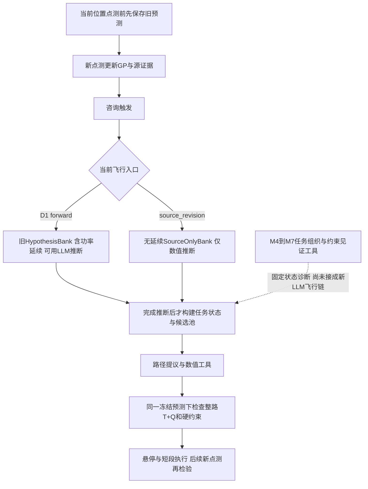

# LLM辅助决策优化：文献与全流程代码审视

2026-11-20，用户要求查方法并检查类似“数值算法错误拒绝LLM”的问题。本轮结论是：**先修共享工具和补齐任务接口，再检验LLM如何组织有限的假设检验、反馈修订与路径搜索。当前连续多个小机制实验未获收益，尚不能把原因归结为LLM本身。** 同时，不能把修好工具或提高接受率当成LLM创新。

本轮没有修改生产源码、测试或C1/D1/M0–M7原件，没有新飞行、真实点测、开发状态拟合、评价真值查询或实验决策调用。3个独立研究/代码审查会话分别负责推断链、规划链和文献，均未读取outputs/隐藏配置/封存数据。根会话只审源码、既有文档和合成反例；先前已见开发结果不能成为新盲决策输入。本轮为审计，不是M8科学运行，也不重开旧预算。

完整证据：[分类发现JSON](findings.json)、[推断独立审查](inference/review.md)、[规划独立审查](planning/findings.md)、[推断反例](inference/evidence.json)、[规划反例](planning/evidence.json)、[回执竞争反例](orchestration/evidence.json)。根会话再次执行了两份组件复现，断言通过。所有数据为脚本明示的人工点/地图，不是旧飞行或未飞区域测量。

## 一、适合借鉴的方法

[本轮文献入口](../../references/llm_decision_review_20261120/README.md)、[逐篇方法与局限](../../references/llm_decision_review_20261120/reviewed_method_notes.md)、[原件/版本/哈希/实际选读范围](../../references/llm_decision_review_20261120/reading_manifest.json)。实际选读5篇原文的方法和局限段，另核对SayPlan出版社摘要、复读ReEvo对比；不声称全文通读或覆盖2025–2026全部最新工作。

|方法与原文|本项目可以借什么|不能直接移植什么|
|---|---|---|
|[LLM-Modulo](https://arxiv.org/abs/2402.01817v3)，ICML2024 §3–3.2|LLM提出受限作业；外部工具检查；返回具体数值反例；少量修订后共同接受。格式、几何/资源、拟合相容、任务差值分层检查|未知电磁场没有完备验证器。通过检查不等于预测真实、安全或任务有效；框架本身已是已有工作|
|[Compound LLM-Modulo实证](https://arxiv.org/abs/2411.14484v1)，§3/5.1/5.4/7|具体批评比只说失败更有信息；可先返回一条最关键批评，保留其他项账本；预算到就停止|其日程任务完整信息、现成评价器不同于本项目；更多历史/更多反思轮并非总有收益，原10轮不直接照搬|
|[ReAct](https://arxiv.org/abs/2210.03629v3)，§2及失败讨论|把实际工具返回用于下一次作业，明确“待区分问题→动作→数值反馈”；记录重复无效调用并退出|预测工具不创造独立传感信息，长理由或LLM自己反省不能代替新证据|
|[LATS](https://arxiv.org/abs/2310.04406v3)，§4/6与附B；[ToT](https://arxiv.org/abs/2305.10601v2)，§3/6与附B.3|可借很浅的分支/回溯，用于冻结公开状态中的机制、路线对和工具顺序；保留已有可行方案|LATS依赖环境可回退，实际飞行/未来点测不能回退；自评分/self-consistency不能当源可信权重；ToT可增加5–100倍生成token，不能用多算力冒充组织收益|
|[SayPlan](https://proceedings.mlr.press/v229/rana23a.html)，仅出版社摘要|高层只处理任务相关部分，经典工具求路径，反馈后迭代重规划|没有取得版本一致全文，不声称读过具体算法；这里也没有已知真实源的语义图|

最适合当前任务的是LLM-Modulo与ReAct中的受限反馈修订流程，先采用少轮、少分支的版本。LATS/ToT只能作为后续可选搜索组织方式。ReEvo/FunSearch式离线代码/算子演化不恢复；该研究线与当前在线点测下的决策任务不同。

SayPlan下载超时与分段ETag不一致均保留记录，没有把拼接片段当原文。OptiGuide仅在收尾时提出候选，本轮未获取/阅读，不作为证据。论文的他域成功率均不移植为本项目收益。

## 二、当前全流程实际上没有接成同一条新LLM主线

[scenario_loop.py](../../../src/uav_em/scenario_loop.py)第25–26、35–49、93–97、125–138行显示：

1. **真实飞行中的推断LLM缺任务上下文。** `run_event`先于任务state、候选池建立；`public_map`只给goal与边界。[inference_request](../../../src/uav_em/event_inference.py)第186–192行和[make_request](../../../src/uav_em/event_llm_inference.py)第43–52行给历史/家族证据/GP软点等，却不给当前未飞路线、建筑、剩余能量/航程、竞争路线/到达时段代价差。它无法像M4–M7那样按任务分歧选修订对象。路径LLM拿到了较多任务信息，但到那时本轮源推断已完成。
2. **无延续源池尚无LLM飞行入口。** `scenario_loop.py:35–36`明确禁止source_revision传入推断advisor；forward仍使用旧HypothesisBank，而后者初始化两个persistence世界。若直接重跑D1 joint_I/J，就会回到旧方法，不能称用户要求的无延续新主方法。
3. **M6修复没有进入飞行共享工具。** [run_event](../../../src/uav_em/event_llm_inference.py)第163–164行仍调用旧`refine_fit`；`constrained_refine_fit`只有[constraint_replay.py](../../../src/uav_em/constraint_replay.py)第45行在调用。几何选项又仅开放给数值source_revision模式。M7剖面也只作池外诊断。

这些是已披露的未集成设计缺口，不是断言旧合同违规。但它们应成为研究优先级：继续仅向固定状态诊断添加一项工具，不等于完善了论文目标中的LLM闭环。

## 三、已经复现的工具问题与接受政策限制

|ID/优先级|位置|合成反例与后果|应如何改|
|---|---|---|---|
|F02 P1，共享选择算子限制|[event_inference.py](../../../src/uav_em/event_inference.py)第254–267、286–291行|满容量warm先占全部槽位，只重新估幅度；新字典基元即使合法、已算核矩阵也不进入求解。容量2、相同2次求解上限：warm MSE325.27，冷字典7.42|旧模型作为可选种子/候选，给冷字典或基元替换一个受账本约束的机会；N/I能力相同，不额外加免费求解|
|F03 P1，条件运行故障|[feasible_scenario.py](../../../src/uav_em/feasible_scenario.py)第55–56行|旧174.6425m路线只因本次新增悬停不再满足能量；160m直达仍合法，却在生成替代路线前直接异常退出|不可行incumbent留拒绝记录，继续检查替代；真正无解时受控停止/修复|
|F04 P2，预算组织缺陷|[feasible_scenario.py](../../../src/uav_em/feasible_scenario.py)第131–143行|默认700采样/10000边、350/350：第一腿第15样本已解，继续优化耗掉后腿机会；剩743边又被固定744保留策略全部锁住。相同地图、中间点、seed、总上限，40/40只用80样本/731边，得到183.9607m合法路线|分别保护后腿搜索与最终复核预算，按实际路径/剩余配额预留；有限搜索仍可失败，但不能把保留策略造成的失败说成无可行中间点|
|F05 P1设计，旧合同内的接受政策限制|[source_geometry.py](../../../src/uav_em/source_geometry.py)第206、243、252行|默认40目标内已评价合法目标0.525680→0.000144，下一请求触发上限后仍返回原种子。旧合同明确要求收敛，现测试也断言保留seed|新合同改为保留最佳已评价合法候选，标记未收敛/非最优；原约束与总预算不变，不回改旧接受标签|
|F06 P2，已有进展丢失|[feasible_scenario.py](../../../src/uav_em/feasible_scenario.py)第35–45行|默认40捷径检查耗尽后丢弃已认证前缀；710.7464m原路线已可组成704.9242m合法部分简化，却返回原路线|返回认证前缀拼原尾段，保留raw再统一整路评分；几何变短不自动代表功率更低|
|F07 P2设计，支持语义问题|[point_gp.py](../../../src/uav_em/point_gp.py)第90–94行及[joint_prediction.py](../../../src/uav_em/joint_prediction.py)第33–41行|t=36查询较近t=0旧点处，稍远40m/t=30新点仍满足80m/35s，却因只检查最近旧点得到unsupported；删旧点则supported、g=.1074|新合同先明确“有效支持”的语义；如采任一合法新鲜点覆盖，GP及融合一致选有效点。旧D1公式冻结了最近点规则，不能称违反旧合同|
|F08 P2，回执发布竞争|[event_demo.py](../../../src/uav_em/event_demo.py)第105–116行|started.json尚在分段写入时被读取，JSON错误立即变回退；人工时钟0.15秒内即终止，未等合法写者完成|生产者原子发布回执；接收者在截止内重试暂时不完整JSON，真正绑定错误仍拒绝。没有证据称历史请求发生过此竞争|

以上反例说明**工具实现、预算与接受政策可以掩盖合法改进或可行提议**，不证明过去某次真实LLM提议因这些问题受损，更不证明修好之后就有任务收益。原数值检查应保留；需要修正错误前置条件和工具能力，不能为接受LLM而放宽几何/资源约束。

低优先级条件问题F11：[state_request](../../../src/uav_em/scenario_planning.py)第192行仅公开楼体outer footprint，未给`holes_m`。含庭院地图的合法区域可能在LLM看来被楼体占据；合成证据见planning/evidence.json。未证明当前开发场景存在该情况。

## 四、方法设计上还应改的部分

**F09：近竞争最低覆盖要由双方共享规则保证。** M4优先级含下一15m距离乘子；M7虽然留了.25底值，仍不保证最近路线被检验。[task_contrast.py](../../../src/uav_em/task_contrast.py)第114–125行按加权对比挑对象，实际M7两方都跳过25秒最近的lattice_46。LLM也主动看重当前动作分歧，因而遗漏了后段重要的竞争。不能只对数值参考加一个弱规则、把更好的覆盖留给LLM；近竞争覆盖应由共同机制支付，之后才比较剩余预算如何组织。重复M7这类单作业、单rate实验应停止作为主推进方式。

**F10：当前能表达的动态机制与绝对适用性都不足。** [operator_dictionary](../../../src/uav_em/event_inference.py)第234–241行让同一世界的所有基元属于同一种家族：平移是四个轴向±3m/s、强度变化是静止±.5dB/s，不能在同一世界表达静态背景＋移动源、移动同时增强等组合。底层场公式能表达复合参数，但LLM共享工具没有提供它；几何工具也不改速度/变化率。M7固定幅度只变单rate且原参数在上界，未找到翻转不足以判断一般相容假设是否任务等价。

[SourceOnlyBank.birth](../../../src/uav_em/source_revision.py)第29–35行在初次有源出生后去掉unknown占位；源标准差固定4dB，家族权重只是现有模型间的相对分数。源幅度/速度/变化率按整个剩余路线外推，未建不确定动态寿命或校准外推区间。沿轨迹MSE下降或某世界相对权重高，不能证明它在未飞区和长时距适用；把“没有新证据”转换为全域置信提升应避免。解决方向不是给某个源加权，而是记录绝对适用性、外推时距及任务排序分歧，允许少量任务相关的联合幅度/动态/每基元机制修订，新版本独立出生。

**路径搜索代理与最终目标不同。** [FrozenSearchObjective](../../../src/uav_em/scenario_planning.py)第229–242行以当前时刻静态场求路径，最终才用实际未来到达时刻重评。这是明示近似，最终接受本身没有换目标；但工具可能只返回静态代理下的一条路径，丢掉动态任务更好的其他候选。可先保留少量几何/到达时间不同的候选再统一重评，或另冻有界时间状态搜索。不要把增大原静态搜索量当作已解决动态优化。

**数值参考要补强。** 飞行数值路径`feedback_plan`只固定延伸共同最优方向；它不足以单独承担论文“强数值优化”基线。后续N应同样有近竞争覆盖、源替换/共同修订、有限多分支及失败后预算重分配。M7两方选择不同路线对，区间宽度/数值高低不能当直接胜负。LLM额外调用/token/墙钟单列，不能仅凭相同工具上限声称同总计算成本。

## 五、已经核对、应保留的部分

- 点测旧预测先冻结，再收新值计分、更新；新版本scored_points归零，拟合历史和pilot已知尾点不计出生后证据。没有发现直接读未来测量或重复计分。
- GP软点只约束形状，不进真实读数历史或独立证据计数；pilot GP与真实拟合均排除尾3点。
- 不同世界先各自算线性功率期望，再按权重组合；GP/源使用单独保存的线性期望积分，没有拿表示混合均值/方差再次对数正态化。
- 当前活动`feasible_scenario.execute`保留raw与shortcut并统一评分，raw好时不会只强留更短路线。`scenario_planning.propose_and_accept`不是当前同步主调用，不能把旧辅助接口当活动逻辑。
- 路线接受在同一冻结forecast与权重下检查整路未来到达T+Q、几何/能量/航程；0.5秒到达延迟、候选能量和实际扣除一致。同事件的共同悬停T/Q不影响路线排序，飞行评价另计。
- 保留原可行方案、非法回复回退、强约束和工具账本。接受器不应直接服从LLM自评分。

## 六、建议的统一流程和停止项

建议后续方法把LLM可检验的作用放在：**决定先质疑哪个等效解释、哪一段未来风险，以及在哪个许可区域使用哪种工具，并根据具体反馈修订尚未执行的计划。** 框架借鉴不是新颖性本身；论文贡献还需证明任务相关组织在同信息/工具/预算下优于强数值组织，且有未来预测/任务效用证据。

目标流程建议：

1. 新点测先检验旧版本，更新局部GP与证据，保留绝对失配标记。
2. 在推断LLM前生成共享任务快照：当前未飞路线、建筑/资源、近竞争路线、逐世界差值和到达时段；共同支付最低覆盖。
3. LLM选择一项待区分假设与有界作业，或keep。任务结构可包含路线对、世界/版本、时间窗、每基元机制/参数族/区域、预期区分问题和预算。
4. 共享工具返回最佳已求得合法候选及具体状态，区分域外、未收敛、预算阻塞、拟合不适用、任务差值无变化；数值反馈不是新观测。
5. 在事前限定总调用和工具上限内，给少量有针对性的修订机会；冻结预测中的分支可复制回溯，实际飞行与未来读数不可回溯。
6. 对所有保留候选用同预测与硬约束复核，按明确新版本出生规则提交，执行短段，下一新点测再检验。

当前应停止：继续只在同三个已见状态加一个工具/参数并以无变化作主结论；追求拟合损失/工具接受率替代任务收益；把任意局部求解未收敛当不存在好解；让LLM同池挑已精确评分argmin；扩大同一搜索/调用量或调权重制造绕路；把条件世界检查当真实场验证；恢复全图最近功率延续、训练/RL/RAG/离线算子演化或异步工程作为当前前置。

建议维护顺序：先完成一批共享工具修复与新接受政策的组件回归（F02–F08；旧合同保留），再建立一条有任务上下文、无延续源池、可调用修复工具的统一LLM入口（F01），然后冻有限反馈修订与强N的同状态合同；最后再按独立合同进入必要新前瞻/闭环N/I/P/J。本轮不启动上述新科学运行。

## 七、验证及边界

[全量测试](full_tests.log)：315 passed，1第三方pytest弃用警告，11.28秒。31个活动模块；[源码指纹](source_fingerprint.json)与M7冻结一致。独立69项推断相关/16项时序测试属于这套已有测试的子集，不能相加冒称更多独立测试。已有测试通过但遗漏了本轮反例；部分测试甚至有意固定了耗尽保留seed/最近点支持等旧政策，后续应在新合同下增加目标性质测试。

根会话重跑了两份合成复现，全部断言通过；回执竞争使用人工时钟且无模型服务。合成脚本存档仅供复核，原样执行会在脚本目录写自己的evidence.json；重现时请复制到新的temp目录并在项目根使用`PYTHONPATH=src`，不要覆盖本审计已存证据。工作区完整性检查应继续报告21个旧时序原件缺失，不更改旧哈希。没有证据证明这些新反例导致了过去某条任务的损失，修复后的真实优化收益仍待前瞻验证。

收尾核验见[verification.json](verification.json)与[workspace_check.json](workspace_check.json)：64项活动源码/测试/冻结合同指纹、1162项C1/D1/M0–M6既有原件、116项M7发布原件均一致；完整性检查仍报原先21个缺失、0新增失败。导航378条及本审查/文献内36条本地链接有效。这里只核文件字节与链接，不重跑旧科学计算。7份导航/交接已同步上述唯一顺序，审查与文献文件清单见[publication_manifest.json](publication_manifest.json)。
